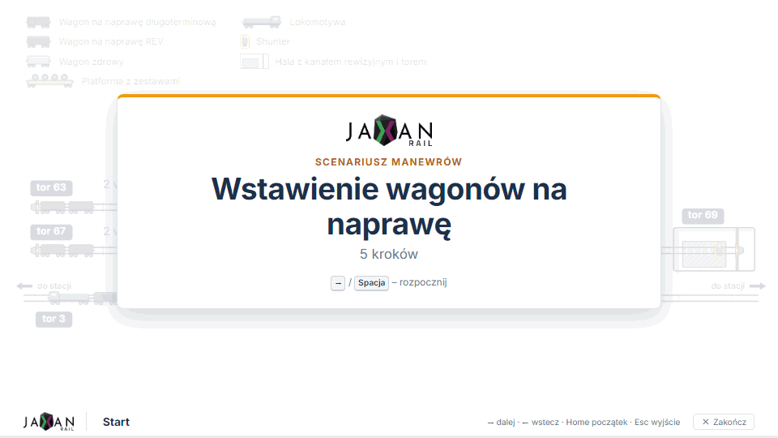
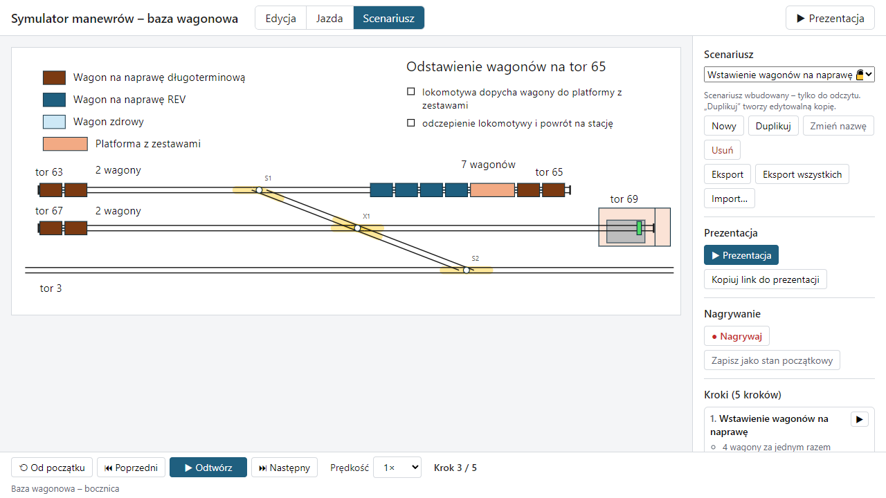
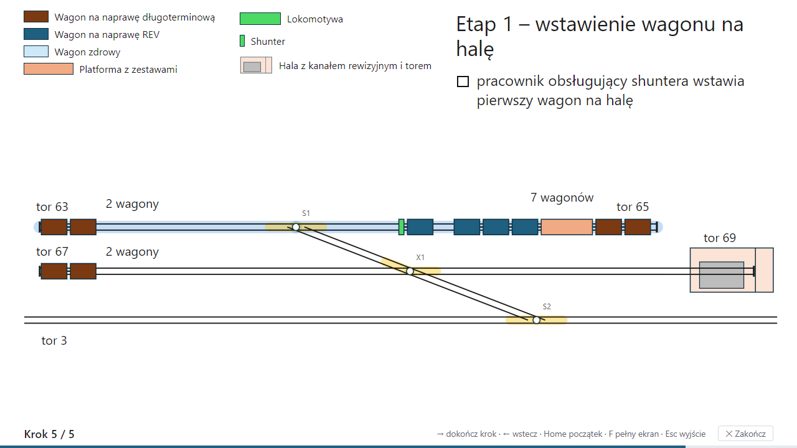

# manewry-baza

Symulator manewrów na bazie wagonowej. Pokazuje schemat bocznicy (tory 3, 63, 65, 67, 69 i halę
z kanałem rewizyjnym) oraz ruchy wagonów wykonywane lokomotywą manewrową lub shunterem. Służy do
**prezentowania zarządowi, jak wstawia się wagony na naprawę**: krok po kroku, z animacją
i podpisami, tak jak na slajdach w [`docs/img/`](docs/img/).

- **Aplikacja online:** https://digital-knight1103.github.io/manewry-baza/
- **Prezentacja scenariusza przykładowego (link bezpośredni):**
  https://digital-knight1103.github.io/manewry-baza/#/prezentacja/wstawienie-na-naprawe

Aplikacja działa w przeglądarce, bez instalacji, także na laptopie podłączonym do rzutnika.
Specyfikacja: [`docs/SPEC.md`](docs/SPEC.md).



| Tryb roboczy (Scenariusz) | Tryb Prezentacja |
|---|---|
|  |  |

## Jak używać
Pasek u góry przełącza tryby: **Edycja | Jazda | Scenariusz**, a przycisk **▶ Prezentacja**
uruchamia pokaz wybranego scenariusza.

| Tryb | Do czego służy |
|---|---|
| **Edycja** | rozstawianie taboru na torach (stan początkowy) |
| **Jazda** | ręczne manewry: jazda lokomotywą lub shunterem, rozjazdy, sprzęganie |
| **Scenariusz** | lista scenariuszy, odtwarzanie krok po kroku, nagrywanie, edycja kroków, eksport/import |
| **Prezentacja** | pełny ekran dla zarządu, sterowanie samą klawiaturą lub pilotem |

### Skróty klawiszowe

| Tryb | Klawisz | Działanie |
|---|---|---|
| Edycja | **Del** / **Backspace** | usuń zaznaczony pojazd |
| Edycja | **Esc** | odznacz pojazd |
| Edycja, Jazda | **Ctrl+Z** / **Ctrl+Y** | cofnij / ponów |
| Jazda, nagrywanie | **←** / **→** (trzymaj) | jazda składem w lewo / w prawo |
| Jazda, nagrywanie | **Spacja** | stop |
| Jazda | **Esc** | anuluj „Ustaw drogę” |
| Scenariusz | **Spacja** | ▶ odtwórz / ⏸ pauza |
| Scenariusz | **→** | następny krok (w trakcie animacji: od razu koniec kroku) |
| Scenariusz | **←** | poprzedni krok |
| Scenariusz | **Home** | od początku |
| Prezentacja | **→** / **Spacja** / **PageDown** | następny krok z animacją; w trakcie animacji: od razu koniec kroku |
| Prezentacja | **←** / **PageUp** | poprzedni krok (natychmiast) |
| Prezentacja | **Home** | ekran tytułowy |
| Prezentacja | **F** | włącz / wyłącz pełny ekran |
| Prezentacja | **Esc** | wyjście z prezentacji |

Pilot do prezentacji wysyła PageUp / PageDown, więc działa bez konfiguracji.

### Tryb Prezentacja
- Uruchomienie: **▶ Prezentacja** w pasku górnym lub w panelu trybu Scenariusz (przy wybranym
  scenariuszu z krokami). Aplikacja przechodzi na pełny ekran, panele i paski edycji znikają.
- Ekran tytułowy z nazwą scenariusza, potem kolejne kroki, na końcu ekran „Koniec”.
- U góry legenda (kolory i nazwy taboru z `station.json`), w prawym górnym rogu ramka z tytułem
  i punktami kroku, jak na slajdach. Pod nimi duży schemat dopasowany do ekranu: 16:9 i 4:3,
  rzutniki 1280×720 i 1920×1080. Tekst skaluje się z ekranem, żeby był czytelny z końca sali.
- Na dole wskaźnik „Krok 3 / 5” i cienki pasek postępu. Kursor myszy chowa się po 2 s bezruchu.
- **Link bezpośredni** `…/#/prezentacja/<id-scenariusza>` otwiera od razu prezentację.
  W trybie Scenariusz przycisk **„Kopiuj link do prezentacji”** kopiuje go do schowka.
  Przeglądarka nie pozwala włączyć pełnego ekranu bez kliknięcia, dlatego po wejściu z linku
  prezentacja wypełnia okno, a **F** przełącza na pełny ekran.
- Scenariusz edytowalny jest zapisany tylko w przeglądarce, w której powstał. Żeby jego link
  działał na innym komputerze, scenariusz trzeba tam zaimportować albo dodać jako wbudowany
  (patrz niżej).

### Tryb Edycja: rozstawianie taboru
- **Dodawanie:** przeciągnij pojazd z legendy (legenda = paleta) na tor. Pojazd przyciąga się do
  najbliższego toru i najbliższego wolnego miejsca, a obok innego pojazdu dosuwa się do niego.
- **Szybkie wypełnienie** (panel boczny): tor, typ, liczba, kierunek dosuwania → „Dodaj”.
  Przykład z rysunku 1: tor 63 → 8, tor 65 → 9, tor 67 (zachód) → 11, tor 69 (hala) → 2,
  tor 67 (wschód) → 7 wagonów REV.
- **Zaznaczanie:** kliknięcie pojazdu. Panel pokazuje typ, numer wagonu (edytowalny), sprzęgi
  z sąsiadami (Sprzęgnij / Rozprzęgnij) i skład.
- **Przesuwanie:** przeciągnięcie pojazdu przesuwa cały jego skład wzdłuż toru i zatrzymuje go
  na innych pojazdach i kozłach. Po puszczeniu mała przerwa (< 12 jedn.) jest domykana.
- Stykające się pojazdy są sprzęgane automatycznie (przełącznik w panelu).
- Stan stacji zapisuje się automatycznie w przeglądarce (localStorage).
  „Wczytaj stan początkowy scenariusza” przywraca przykład.
- „Zapisz jako stan początkowy scenariusza” zapisuje bieżący stan stacji do scenariusza wybranego
  w trybie Scenariusz (tylko edytowalnego).

### Tryb Jazda: ręczne manewry
- **Pojazd prowadzący:** kliknij lokomotywę lub shunter (żółta poświata i czerwona strzałka
  kierunku). Kliknięcie wagonu tylko pokazuje o nim informacje.
- **Jazda:** przytrzymaj ◀ / ▶ w panelu albo klawisze **←** / **→**. Skład jedzie, dopóki
  trzymasz. Kierunek jest ekranowy: na łączniku ◀ = w górę-lewo, ▶ = w dół-prawo.
  Suwak ustawia prędkość animacji.
- **Rozjazdy:** kliknięcie kółka S1 / X1 / S2 przestawia rozjazd na następny stan; aktywna droga
  jest podświetlona. Zajętego rozjazdu nie da się przełożyć.
- **Ustaw drogę:** wybierz pojazd, kliknij „Ustaw drogę”, a potem tor docelowy. Aplikacja ustawi
  rozjazdy i podświetli drogę. Jeśli po drodze trzeba zmienić kierunek, pasek stanu podpowie,
  gdzie to zrobić i które rozjazdy przestawić.
- **Sprzęganie:** kliknięcie przerwy między sprzęgniętymi pojazdami je rozprzęga (kursor ✂),
  a między stykającymi się niesprzęgniętymi je sprzęga. „Auto-sprzęganie” łączy składy przy najechaniu.
- **Zjedź ze stacji:** skład na końcu toru 3 może opuścić schemat.
- **Cofnij / Ponów:** Ctrl+Z / Ctrl+Y. „Reset do stanu początkowego” przywraca stan z chwili
  wejścia w tryb Jazda.

### Tryb Scenariusz: odtwarzanie, nagrywanie, edycja
- **Lista scenariuszy:** wybór, **Nowy** (stan początkowy = bieżący stan stacji), **Duplikuj**,
  **Zmień nazwę**, **Usuń**. Scenariusze wbudowane (🔒) są tylko do odczytu; „Duplikuj” tworzy
  ich edytowalną kopię. Edytowalne scenariusze zapisują się automatycznie w przeglądarce.
- **Odtwarzanie** (pasek na dole): ⟲ Od początku, ⏮ Poprzedni, ▶ Odtwórz / ⏸ Pauza, ⏭ Następny,
  prędkość 0,5×–4× (ta prędkość obowiązuje też w prezentacji). W trakcie przejazdu podświetlona
  jest droga, przy przełożeniu – rozjazd, a akcja `highlight` pulsuje wskazane pojazdy lub tor.
- **Skok do kroku:** kliknięcie tytułu kroku na liście od razu pokazuje stan po tym kroku;
  ▶ przy kroku odtwarza tylko ten krok.
- **Edycja kroków** (scenariusz edytowalny): ✎ tytuł i punkty opisu (jeden punkt w wierszu),
  ↑ ↓ kolejność, ✕ usunięcie, „Akcje (n)” – podgląd listy akcji.
- **Eksport / Import JSON:** „Eksport” zapisuje bieżący scenariusz, „Eksport wszystkich” – komplet
  w jednym pliku. „Import…” przyjmuje oba formaty: scenariusz o tym samym id jest zastępowany,
  a wbudowany nie zostanie nadpisany, tylko dostanie nowe id.
- Błędna akcja (np. rozjazd ustawiony przeciwnie) zatrzymuje odtwarzanie z komunikatem
  „Krok N, akcja M: …”; kroki za błędem są niedostępne.

## Jak nagrać i dodać nowy scenariusz
1. **Edycja:** rozstaw tabor tak, jak ma wyglądać na początku.
2. **Scenariusz → Nowy:** podaj nazwę. Stanem początkowym zostaje bieżący stan stacji.
3. **● Nagrywaj:** kliknij lokomotywę lub shunter i wykonuj manewry jak w trybie Jazda.
   Do bieżącego kroku zapisują się: przełożenie rozjazdu, zakończony przejazd (jako „jedź do”
   punktu zatrzymania; najechanie z auto-sprzęganiem jako „dojedź i sprzęgnij”), sprzęgnięcie,
   rozprzęgnięcie i „Zjedź ze stacji”.
4. **Nowy krok:** podaj tytuł kolejnego etapu (np. „Etap 2 – …”) i nagrywaj dalej.
   **↶ Cofnij akcję** usuwa ostatnią nagraną akcję, **■ Zakończ** kończy nagrywanie.
5. Na liście kroków **✎** dopisz punkty opisu, które pojawią się w ramce w prawym górnym rogu.
6. Sprawdź całość przyciskiem **▶ Odtwórz**, potem **▶ Prezentacja**.

Scenariusz zapisuje się w tej przeglądarce. Aby przenieść go na inny komputer, użyj
**Eksport** / **Import…**.

**Scenariusz wbudowany** (dostępny dla wszystkich pod adresem GitHub Pages i z linkiem
bezpośrednim):
1. **Eksport** zapisuje plik `<id>.json`.
2. Skopiuj go do [`src/data/scenarios/`](src/data/scenarios/). Wszystkie pliki z tego katalogu
   są wczytywane automatycznie, kod nie wymaga zmian. Pole `id` musi być unikalne, bo staje się
   częścią linku `#/prezentacja/<id>`.
3. `npm test` (testy sprawdzają, że scenariusze wbudowane odtwarzają się bez błędów), commit,
   push. Po wdrożeniu scenariusz jest dostępny online z kłódką 🔒.

Format pliku i lista akcji: [SPEC rozdz. 10](docs/SPEC.md#10-format-scenariusza).
Przykład: [`src/data/scenarios/wstawienie-na-naprawe.json`](src/data/scenarios/wstawienie-na-naprawe.json).

## Jak zmienić układ torów lub długości pojazdów
Cały schemat jest sterowany danymi z [`src/data/station.json`](src/data/station.json).
Współrzędne są w jednostkach viewBox 1000×400 (oś y w dół).

| Pole | Co zmienia |
|---|---|
| `nodes` | węzły: kozły (`bufferStop`), rozjazdy (`switch`), granice torów (`boundary`), wyjazdy ze stacji (`exit`) z pozycją `x`, `y` |
| `edges` | odcinki torów między węzłami (`from`, `to`, numer toru `track`, opcjonalne punkty pośrednie `points`) |
| `switches` | stany rozjazdów: które odcinki łączy każdy stan, stan domyślny |
| `boundaries` | przejścia między odcinkami bez rozjazdu (np. granica toru 67/69) |
| `hall` | prostokąt hali, ściana, kanał rewizyjny, kolory |
| `labels`, `counters` | etykiety „tor 63” i liczniki wagonów |
| `vehicleTypes` | typy taboru: nazwa w legendzie, kolor, **`lengthM` – długość w metrach**, `powered` (lokomotywa / shunter), `maxWagons` (ile wagonów może pchać shunter) |
| `scalePxPerMeter` | skala: długość prostokąta pojazdu = `lengthM × scalePxPerMeter` |
| `couplingGapM` | przerwa na sprzęg między pojazdami |
| `switchFoulingDistance` | odległość od rozjazdu, od której pojazd go zajmuje |

Po zmianie uruchom `npm test`: testy silnika i scenariusza przykładowego wychwycą układ, w którym
scenariusz przestał się odtwarzać (np. tor stał się za krótki dla dłuższych wagonów). Wzór
układu jest też w [`docs/station.json`](docs/station.json).

## Założenia do potwierdzenia
Przyjęte w aplikacji, do potwierdzenia z zamawiającym (SPEC rozdz. 15):

1. **Punkt X1:** przyjęto, że to rozjazd i z łącznika można wjechać na tor 67/69 (do hali).
   Jeśli w rzeczywistości jest tam tylko skrzyżowanie, zmienia się to wyłącznie w `station.json`.
2. **Granica torów 67/69:** przyjęto, że tor 69 zaczyna się na wjeździe do hali.
3. **Tor 3:** przyjęto, że po obu stronach prowadzi do stacji (wahadło).
4. **Długości taboru:** przyjęto wagon 15 m, platformę 30 m, lokomotywę 25 m, shunter 3 m;
   shunter pcha maks. 4 wagony. Rzeczywiste wartości trzeba potwierdzić.
5. **Pojemność hali:** czy na hali mieści się jeden wagon naraz, czy kilka?

## Uruchomienie lokalne
Wymagany Node.js 18+.

```bash
npm install
npm run dev      # serwer deweloperski (http://localhost:5173/manewry-baza/)
npm run build    # build produkcyjny do dist/
npm test         # testy Vitest
npm run lint     # ESLint
```

## Stan prac
- [x] E0 – szkielet (Vite + React + TypeScript, ESLint, Vitest, Zustand) i publikacja na GitHub Pages
- [x] E1 – statyczny schemat stacji rysowany z `src/data/station.json`
- [x] E2 – tabor i tryb Edycja
- [x] E3 – silnik ruchu + testy
- [x] E4 – tryb Jazda
- [x] E5 – scenariusze (odtwarzanie, nagrywanie, edycja kroków, eksport/import)
- [x] E6 – tryb Prezentacja, link bezpośredni, README

## Publikacja
Każdy push na `main` uruchamia `.github/workflows/deploy.yml` (lint, testy, build, deploy).
W ustawieniach repozytorium: **Settings → Pages → Source: GitHub Actions**.
